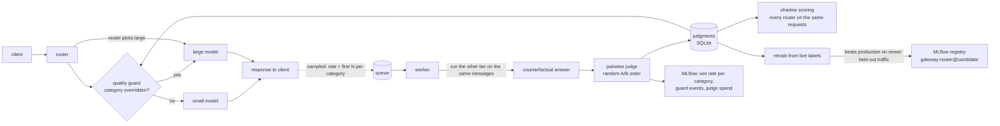

# Online evaluation

The offline benchmark decides whether a router is allowed to launch. After
launch the questions change: is the small model still good enough on what
people actually send, and with the model version the provider is serving
this week? This loop answers that on live traffic, off the request path.

## How it works



1. **Sample.** After a response is sent, the request is offered to a sampler:
   a fixed rate (5% by default) plus the first 20 requests of every request
   category, so a new kind of traffic is measured right away. Cached,
   explicit-model and empty responses are skipped. The queue is bounded and
   never blocks a request.
2. **Counterfactual.** A worker runs the other tier on the same messages. Each
   judged request now has both answers.
3. **Judge.** A pairwise judge scores both answers 1-5 without a reference.
   The two answers are shown in random order and mapped back, so position
   bias can't favour a tier. The label is the one the router is trained on:
   was the small answer at least as good as the large one?
4. **Guard.** For each category (code, math, reasoning, lookup, general) the
   guard tracks the small model's win rate on requests the router chose to
   send small. Below 80% on at least 20 judgments, that category goes to the
   large model. The small model keeps being measured while overridden
   (sampled requests still get a counterfactual small answer), and the
   override lifts when the rate is back to 85%. Switching routers clears the
   evidence, so a new router has to earn its way back.
5. **Shadow scoring.** Because both outcomes are known, any router can be
   scored on the same live requests exactly: take the outcome of the tier it
   would have picked. `GET /admin/online-eval` shows every configured router
   next to the active one, plus the large-only and oracle ceilings.
6. **Retrain and promote.** `scripts/retrain_from_live.py` trains a candidate
   on older judgments (plus offline benchmark labels when present), picks the
   probability cut-off whose out-of-fold precision meets the quality bar, and
   scores it on the newest judgments it never saw against what production
   serves today (active router plus current guard overrides). It is promoted
   only for equal-or-better quality at lower cost, or clearly better quality
   at similar cost. Every run is logged to MLflow; promoted candidates are
   registered as `gateway-router@candidate`.

## Results on a simulated traffic shift

`scripts/online_eval_demo.py` runs the loop through the real gateway API with
a simulated provider and judge, so it needs no API key. Traffic starts like
the benchmark, then short "What is the tax treatment of ...?" questions
arrive. They look like simple lookups to the router, go to the small model,
and mostly get wrong answers. The benchmark has no such prompts, so offline
numbers don't move.

Full table: [online-eval-results.md](online-eval-results.md). Over 8 seeds:

- served quality with the guard: median 0.90, against 0.68 for the same
  router on the same traffic without it
- the guard switched the category over a median of 234 requests after the
  shift began (at a 15% sample rate; the delay scales with the sample rate
  and the guard window)
- the retrained router passed the promotion gate in 4 of 8 seeds, bringing
  cost from $0.84 to $0.71 per 1k requests at 0.93 quality; in the other 4
  the gateway kept serving the guarded router

## Run it

```bash
pip install -r requirements.txt -r requirements-online.txt   # MLflow is optional
python scripts/online_eval_demo.py --seed 7 --mlflow --work-dir var/demo
mlflow ui --backend-store-uri sqlite:///var/demo/mlflow.db    # metrics, events, registry
python scripts/online_eval_report.py                          # multi-seed table
```

On real traffic, set `online_eval.enabled: true` in `config.yaml`, then:

```bash
curl localhost:8020/admin/online-eval          # win rates, guard state, shadow scores
python scripts/retrain_from_live.py --guarded lookup
```

## Config

| key | default | meaning |
|---|---|---|
| `sample_rate` | 0.05 | share of traffic judged after warm-up |
| `warmup_per_category` | 20 | always judge the first N requests of a category |
| `judge_budget_usd` | 5.0 | cap on counterfactual + judge spend per process |
| `guard_threshold` | 0.80 | minimum small-model win rate per category |
| `guard_window` / `guard_min_samples` | 50 / 20 | rolling window and evidence needed to act |
| `guard_recover_margin` | 0.05 | release only at threshold + margin |
| `shadow_routers` | v1, v2, v3 | routers scored next to the active one |
| `tracker` | auto | MLflow when installed, JSONL otherwise |

## Cost

A judged request costs one extra model call (the other tier) and one judge
call on the large model. At a 5% sample rate that is roughly 5-10% on top of
serving spend, and `judge_budget_usd` caps it.
